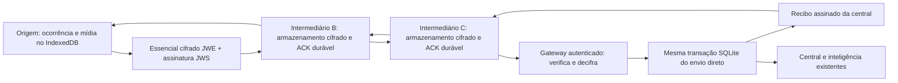

# Arquitetura incremental da Rede Solidária

ATRAVOZ permanece a marca, pasta e pacote existentes. Antena Humana designa a evolução de transporte proposta pelo idealizador. Implementação experimental de store-carry-forward; não há roteamento IP mesh nem rádio nativo nesta versão.

| Camada | Implementação |
|---|---|
| Contratos e envelope | `packages/mesh-core/src/protocol.ts` |
| Cifragem, credenciais, assinaturas, rota | `security.ts` |
| Política, energia, internet e exclusão mútua | `resource-policy.ts` |
| Fila, tombstones, identidade, recibos, métricas | `storage.ts` |
| Encaminhamento, gateway, ACK e retorno | `node.ts` |
| Fragmentação e remontagem limitada | `framing.ts` |
| Transporte real entre navegadores | `webrtc.ts`: WebRTC, sinalização manual |
| Participação e integração com fila original | `apps/citizen-app/src/features/mesh/MeshPanel.tsx` |
| Autoridade, convites, decriptação e gateway | `services/api/app/mesh.py` |
| Qualidade de métricas de transporte | `services/intelligence/src/intelligence/transport_quality.py` |

O IndexedDB original `resilient-records` continua na versão 1. O novo `resilient-mesh-v1` tem stores messages, seen, receipts, sessions e settings. Cotas não apagam ocorrências próprias nem seus anexos. SQLite recebe tabelas aditivas, sem reconstruir tabelas anteriores. A função interna `persist` é compartilhada pelos dois ingressos; o gateway grava ocorrência e recibo mesh na mesma transação.

No agendador do cidadão, essenciais próprios vêm primeiro, essenciais de relay autorizados entram antes dos anexos próprios. Falha da extensão é isolada e não impede o envio de mídia pelo fluxo anterior. O lote original continua limitado a dez registros por ciclo; novas chegadas podem aguardar o ciclo seguinte. Não há garantia de escalonamento global entre aparelhos.

Os intermediários só retêm o conteúdo cifrado. A interface mostra contagens; não recebe a chave privada central nem decifra relato, localização ou chave de escrita. Metadados de identidade, tamanho, tempo e rota continuam visíveis. Descoberta automática, execução com app fechado e transportes nativos são pendências explícitas em [compatibilidade](MESH_COMPATIBILITY.md).
